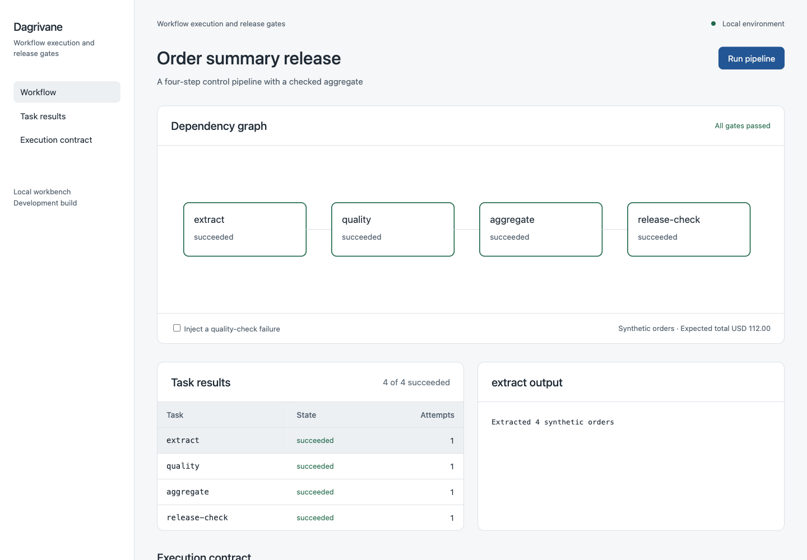

# Dagrivane

Inspect local command workflows and verify data release gates.

## Run the workbench

From a source checkout with Python 3.10 or later:

```sh
python3 -m dagrivane.web
```

Open http://127.0.0.1:8411. No third-party runtime packages are required.
The workbench is a local development application, not a hosted multi-user service.
Run it from the checkout: bundled examples are not yet distributed in an installed package.

## Workbench preview



## Command line

```sh
python3 -m dagrivane examples/pipeline.json --run-id walkthrough
python3 -m unittest discover -s tests -v
```

## Implemented

Validates command graphs before execution, runs dependency-ordered tasks, persists checkpoints in SQLite, verifies declared input content hashes, retries failed tasks within a declared limit and blocks dependent work when a prerequisite fails. The bundled four-stage pipeline extracts synthetic orders, checks them, calculates an exact decimal total and verifies a release gate.

## Boundaries

The runner is local and sequential. Commands are trusted local programs, not sandboxed workloads. Captured output is not a secret store. A process crash may leave external effects with an unknown outcome; the runner refuses to silently retry a task marked running. Concurrent workers, scheduling, connector SDKs, CI promotion and tenant isolation are planned, not implemented.

## Development scope

[Architecture](docs/ARCHITECTURE.md) explains the current execution path.
[Product scope](docs/PRODUCT_SCOPE.md) describes the broader proposed subsystems.
[Weekly roadmap](docs/proposed-weekly-roadmap.csv) is a planning scenario.
[Tasks](TASKS.md) and [request register](REQUESTS.md) track actual status.

## History note

This repository was assembled starting in November 2026. Earlier Git timestamps,
where used, represent reconstructed development stages, not verified original
work in those years. The 2019–2026 roadmap is proposed scope, not a completed-work record.
