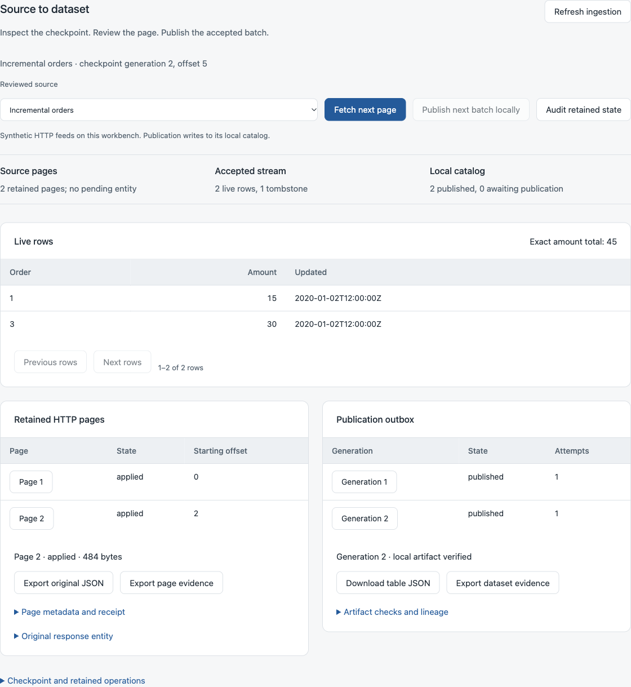
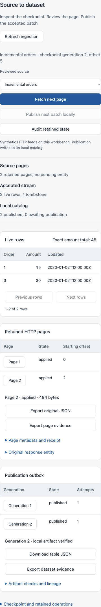
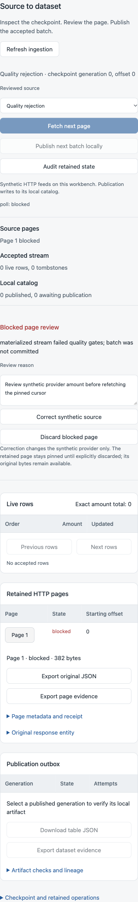

# Source-to-dataset workbench

The ingestion workbench exposes actual HTTP-source checkpoints, retained response entities, typed live rows, quality rejection and the ordered catalog outbox. It uses the same HTTP connector, ingestion store, quality gates and catalog publisher as the CLI. Its three reviewed synthetic profiles run over real HTTP on the workbench's own loopback server.

Start with `python -m dagrivane.web` and open **Ingestion**. **Initialize reviewed sources** creates a separate local ingestion database and catalog. This action is repeatable; it does not reset existing checkpoints or delete evidence.

## Reviewed controls

- **Incremental orders**: the first page creates orders 1 and 2, total 30. The second revises order 1 to 15, deletes order 2 and creates order 3 at 30. Final live keys are 1 and 3, amount total 45, with one tombstone.
- **Quality rejection**: the first response contains amount 2000, exceeding the stream's 1000 budget gate. The whole page is blocked without advancing data, cursor or the publication outbox. Further polls do not refetch the pinned page.
- **Transient HTTP failure**: the synthetic provider sends one 503 with Retry-After 0, followed by the normal first page. The retry is a real second HTTP request, visible in provider counters and retained request metadata.

Source request counters are diagnostic observations, not proof of remote data completeness. The synthetic endpoint can also be visited directly; such visits affect its counters/retry control. Browser requests cannot define another URL, credential, source, contract or catalog destination. Reviewed polling additionally checks the stored endpoint/authentication/redirect policy before making a network call.

## From page to publication

**Fetch next page** performs one bounded connector step, including any already-fetched resumable page. A continuing response reports `limited`, meaning more pages remain after this step; it does not mean the accepted page failed. A terminal response reports `drained`. An idle HTTP 204 retains its entity observation but creates no extra data generation.

The source, stream, current records, provider control and outbox projection are read in one SQLite transaction. The view identifies its data revision. Numeric stream offsets and hashed opaque provider cursors remain separate concepts. Live rows are paged 25 at a time; the amount total is computed over all retained live rows using an isolated exact-decimal context, independent of the display page.

**Publish next batch locally** processes exactly the currently selected outbox head. Data acceptance and catalog publication are separate steps. Generation 2 waits behind generation 1 and cites the previous artifact as its parent. The resulting artifact is verified against stored content and policy before acknowledgment. Local publication does not deploy a service or upload data.

Select a retained page for its original entity, metadata, receipt, rejection or review reason. **Export original JSON** downloads the actual bytes, without parsing and reserializing numeric values in the browser. **Export page evidence** also retains base64 bytes and hashes. Display previews may be shortened at 32,768 characters; exports retain the complete entity.

Select a published generation to verify its catalog object, acknowledgment and original outbox-bundle identity. **Download table JSON** returns the verified table bundle bytes. **Export dataset evidence** includes those bytes, artifact metadata, checks, identity and parent references. A failed inspection clears export state. Unpublished generations cannot be exported as verified artifacts.

## Blocked page review

A reason is required for both review actions:

1. Inspect the blocked original response and the source error.
2. **Correct synthetic source** changes only this local control provider's future response. The retained invalid page remains pinned, its bytes and cursor unchanged.
3. **Discard blocked page** records the review reason and keeps the original entity in history. It clears that pending page without advancing the stream offset or provider cursor.
4. **Fetch next page** requests the corrected entity at the same cursor. Continue with the next page and publish accepted batches separately.

The correction control is available only for the reviewed quality profile. This is an operator action on synthetic data, not an automatic repair or remote-provider mutation. Discarding without correcting the provider will fetch another rejected page. Active worker ownership blocks conflicting review actions.

## Durable actions and interruption

Each mutating browser action carries an idempotency key and expected view revision. The journal stores the requested action's identity, started/completed/failed state, result/error and receipt fingerprint. The browser retains the same request after an unconfirmed response. Repeating it retrieves its existing receipt instead of fetching another page or publishing another batch. Reusing its key with different controls is rejected.

The source chain is checked again inside the connector's claim transaction. The publication head is checked inside the outbox claim transaction. A concurrent CLI worker cannot cause an old workbench action to silently process the next page or generation. Source leases, heartbeat fencing and publication leases remain the authoritative ownership mechanisms.

The operation journal is committed before the network/core action; completion is recorded afterward. These transactions are deliberately distinct. If the process stops between them, a `started` receipt does not establish rollback or non-execution. The same request is not automatically rerun. Refresh and inspect the durable checkpoint/pages/outbox, then decide whether a new action is appropriate. The **Checkpoint and retained operations** section exposes the latest ten receipts, including incomplete or failed ones.

A browser refresh deliberately reviews current durable state and clears that page's unconfirmed request cache. A browser reload loses its in-memory request key; inspect retained operations before starting new work after an uncertain reload. This is single-user local control, with one workbench mutation at a time. Independent CLI workers use the underlying ownership fences.

## Persistence and bounds

State lives under `.local/dagrivane/ingestion-workbench/`, respecting the existing Dagrivane state-directory setting. The ingestion database and local catalog are separate from workflow operations and release controls. Original stream/source definitions remain immutable.

The source URL includes the workbench's actual loopback port. Resume on that same port after a restart. A changed port permits retained-state inspection but blocks new polling until the original workbench port is used; the application does not silently rewrite immutable source endpoints. Initialization with a different origin is rejected.

Each action polls one page with a ten-second deadline and a fifteen-second renewable source lease. Existing connector retry, entity and journal budgets still apply. Pages and outbox entries are displayed in stable pages of 25; live rows use the same page size. Operation receipts are limited to 2,000 per workbench, 2 MiB per result and a 32 MiB logical result budget. Metadata, SQLite pages/WAL, source entities and catalog objects require additional disk space; this is not a physical disk quota or retention/deletion policy.

**Audit retained state** runs three bounded consistency checks: source/entity/checkpoint replay, ingestion/catalog replay and operation-receipt fingerprints. Each check has its own coherent read view; the combined result is not a cross-database transaction. Source/data audits stop at 100 pages/batches; receipt audit stops at 100 operations or 16 MiB. A partial audit reports failure/incompleteness, not a full pass. The existing CLI can inspect larger retained histories with its documented limits:

```sh
python -m dagrivane.http_source --database .local/dagrivane/ingestion-workbench/ingestion.sqlite audit healthy
python -m dagrivane.ingest_cli --database .local/dagrivane/ingestion-workbench/ingestion.sqlite audit healthy --catalog .local/dagrivane/ingestion-workbench/catalog
```

Hashes and replay validate local consistency. They do not authenticate a remote source, historic development dates, complete upstream records or a signed provenance chain. No external provider or credential is configured by these browser controls.

Provider management for general remote feeds, schema migration, automatic retention/deletion, watched ingestion/publication services, signed provenance and the full product/20,000 useful-SLOC requirement remain open.

## Verified checkpoint

Twenty-four new checks and 187 Dagrivane tests passed. Clean installed controls covered one-page receipt retries, real HTTP, quality rejection and review/refetch, ordered local publication, independent raw-event reduction and catalog byte/lineage verification. Browser checks covered original JSON/dataset downloads, keyboard review, delayed page/artifact replies, lost-response recovery, failed-export invalidation and same-port process restart. Evidence: `ingestion-workbench-verification.json` and `ingestion-browser-verification.json`.

A real local HTTP workload retained 150 responses: two data pages and 148 idle entities, five changes and exactly two data generations. All six pages of 25 retained entities had distinct identities. The bounded workbench audit reported incompleteness; the full core CLI audit passed. One observed run took about 2.47 seconds; this is not a throughput or capacity guarantee. Timing, inputs, limits and code identities are in `ingestion-benchmark.json`; the reproduction script is in local planning tools.






